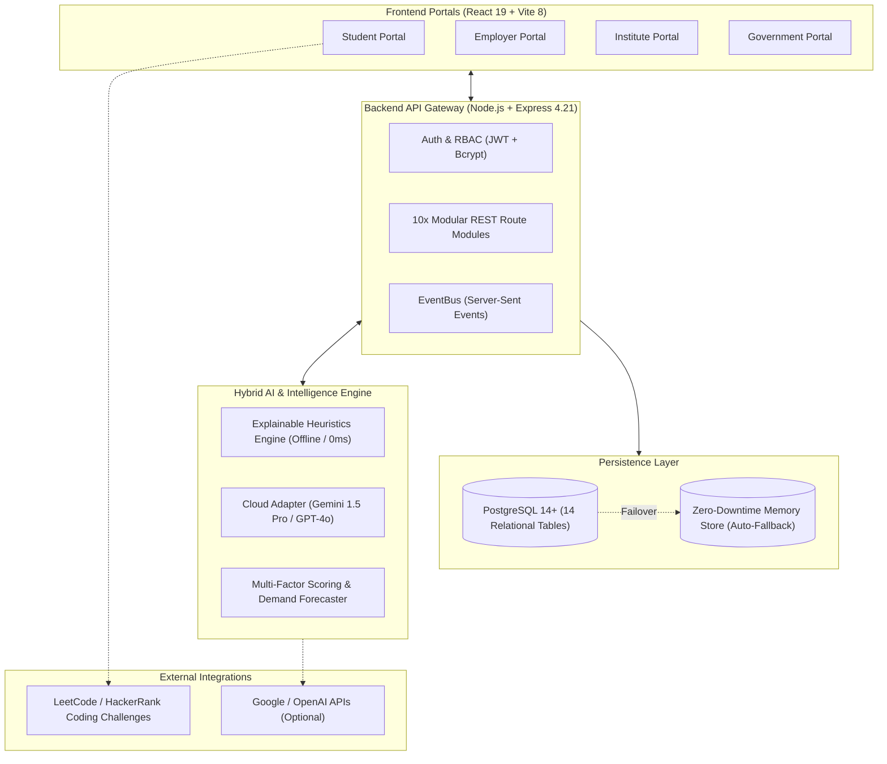
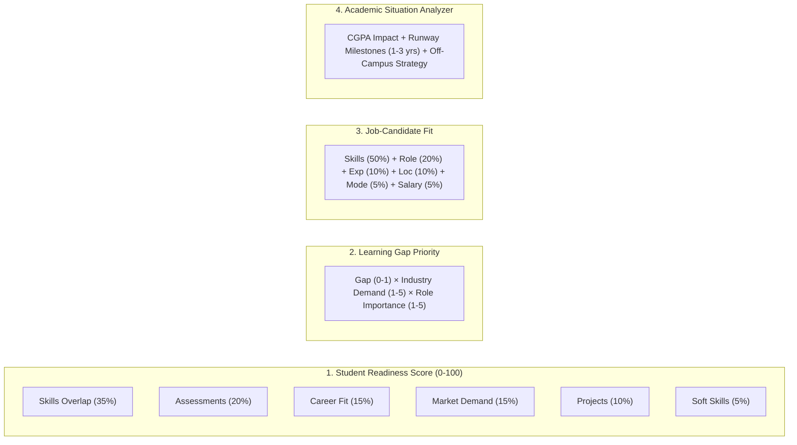
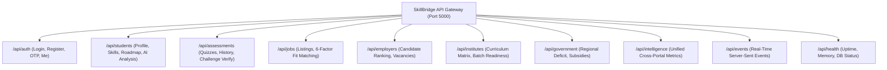
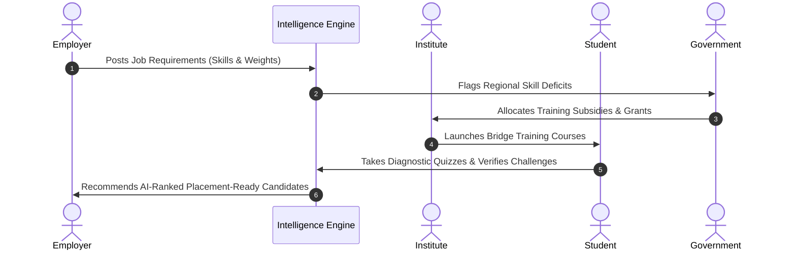

# Technical Analysis & System Architecture Report: SkillBridge Platform

**Platform Name**: Industry Skill Alignment Platform (SkillBridge)  
**Document Version**: 2.0 (Executive Edition)  
**Date**: September 2026  

---

## 1. High-Level Architecture



---

## 2. AI Tools, Models & Mathematical Algorithms

### A. Pluggable AI Provider Architecture (`backend/services/aiProvider.js`)

```mermaid
flowchart LR
    REQ[Client Request] --> PROV{AI_PROVIDER Mode?}
    
    PROV -->|none (Default)| LOCAL["Local Heuristics Engine<br/>• 100% Offline<br/>• 0ms Latency<br/>• Zero Cost"]
    PROV -->|gemini| GEMINI["Google Gemini 1.5 Pro<br/>• Narrative Insights"]
    PROV -->|openai| OPENAI["OpenAI GPT-4o<br/>• Career Guidance"]

    GEMINI -->|Timeout > 5s or Error| LOCAL
    OPENAI -->|Timeout > 5s or Error| LOCAL
    
    LOCAL --> RES[Sanitized Response]
```

#### Core AI Principles & Guardrails:
1. **Mathematical Immutability**: All quantitative readiness scores, match percentages, and salary estimations are strictly computed by deterministic equations. Cloud LLMs are restricted to narrative summaries, career advice, and situational explanations.
2. **Zero-Latency Offline Mode**: Works completely without internet or API keys using rule-based explainability heuristics.
3. **5000ms Timeout Guard**: External API calls are guarded by an `AbortController` timeout that falls back instantly to the local engine.

---

### B. Mathematical Formulations & Intelligence Engines



1. **Explainable Readiness Scoring Engine (`predictionService.js`, `skillEngineService.js`)**:
   $$\text{Readiness} = 0.35 \cdot S_{\text{skills}} + 0.20 \cdot A_{\text{assessment}} + 0.15 \cdot C_{\text{career}} + 0.15 \cdot M_{\text{market}} + 0.10 \cdot P_{\text{projects}} + 0.05 \cdot K_{\text{soft}}$$
2. **Prioritized Learning Engine (`recommendationService.js`)**:
   $$\text{Priority Score} = \text{Skill Gap} \times \text{Industry Demand Weight (1–5)} \times \text{Role Importance (1–5)}$$
3. **6-Factor Job Fit Matcher (`jobController.js`)**:
   $$\text{Job Fit} = 0.50 \cdot \text{Skills} + 0.20 \cdot \text{Role} + 0.10 \cdot \text{Experience} + 0.10 \cdot \text{Location} + 0.05 \cdot \text{Mode} + 0.05 \cdot \text{Salary}$$
4. **Predictive Demand Forecaster (`predictionService.js`)**:
   Classifies market competencies into *Critical Shortage, High Growth, Emerging, Stable Core, Declining*.
5. **Ecosystem Intelligence Engine (`intelligenceEngine.js`)**:
   Computes National Employability Index ($76.4\%$) and synchronizes cross-portal supply & demand.

---

## 3. APIs Used in the Platform



### Route & Service Inventory:

| Route Group | HTTP Methods | Endpoint | Functional Description |
| :--- | :--- | :--- | :--- |
| **Authentication** | `POST`, `GET` | `/api/auth/*` | Registration, login, profile retrieval, password reset & OTP |
| **Students** | `GET`, `POST`, `PUT` | `/api/students/*` | Profile editing, verified skill tracking, roadmap, AI situation analysis |
| **Assessments** | `GET`, `POST` | `/api/assessments/*` | Diagnostic quizzes, historical analytics, LeetCode challenge verification |
| **Jobs** | `GET`, `POST` | `/api/jobs/*` | Search, filtering, job posting, and 6-factor candidate match scoring |
| **Employers** | `GET`, `POST` | `/api/employers/*` | Organization profile, AI-ranked candidate cohorts, talent pipeline |
| **Institutes** | `GET`, `POST` | `/api/institutes/*` | Curriculum alignment matrix, cohort readiness stats, bridge training |
| **Government** | `GET`, `POST` | `/api/government/*` | Regional deficit heatmaps, demand forecast, policy subsidy allocations |
| **Intelligence** | `GET` | `/api/intelligence/*` | Central cross-portal analytics, National Employability Index |
| **Real-Time Stream** | `GET` | `/api/events` | Server-Sent Events (SSE) broadcasting live events across tabs |
| **System Health** | `GET` | `/api/health` | PostgreSQL connectivity, uptime, memory, and service status |

---

## 4. Cross-Portal Coordination Flow



---

## 5. Technology Stack Summary

| Layer | Technologies Used | Key Responsibilities |
| :--- | :--- | :--- |
| **Frontend UI** | React 19, Vite 8, React Router 7 | Responsive single-page application, client state management |
| **Styling & Theme** | Tailwind CSS, Glassmorphism, CSS Custom Vars | Modern UI, responsive typography, dark/light theme |
| **Backend Runtime** | Node.js (ES Modules), Express 4.21 | REST API routing, SSE streaming, authentication |
| **Security & Headers** | Helmet, CORS, express-rate-limit, Bcrypt, JWT | Hardened HTTP headers, rate limiting, secure password hashing |
| **Database** | PostgreSQL 14+ (`pg` pool) & Fallback Memory Store | 14 normalized tables with zero-downtime offline failover |
| **AI / ML** | Explainable Rule Heuristics, Google Gemini, OpenAI | Multi-factor mathematical scoring + contextual narrative guidance |
| **Visualization** | Native Responsive SVG Diagrams | Dynamic donut completion gauges, progress tracks, matrix bars |
| **External Platforms** | LeetCode & HackerRank | Deep-linked coding problems, solution blueprints & starter templates |

---

## 6. How to Run Locally

```bash
# 1. Install dependencies
npm run install:all

# 2. Run in development mode (Concurrently starts backend on :5000 & frontend on :5173)
npm run dev

# 3. Run production build & verify
npm run build
npm run lint
```
